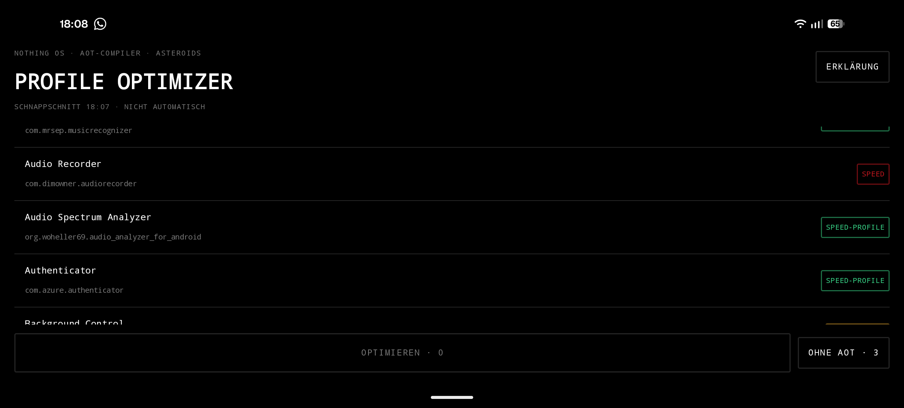
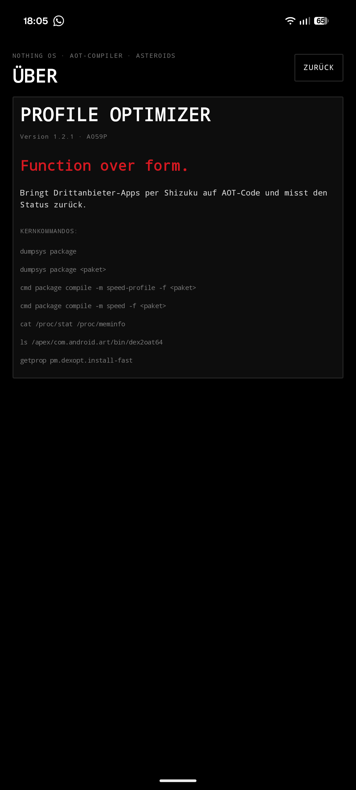
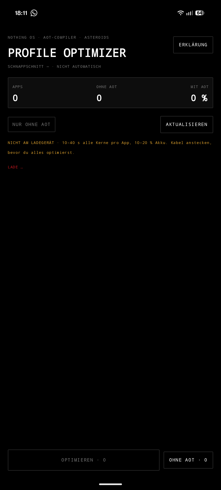

# Profile Optimizer

Android-Apps ohne Root auf echten Maschinencode bringen. Die App listet alle Drittanbieter-Apps, zeigt
ihren ART-Status und kompiliert sie über Shizuku vor — mit `speed-profile` und automatischem Rückfall auf
volles `speed`, wenn eine App kein Nutzungsprofil hat.

Gebaut für Nothing OS, läuft aber auf jedem Android ab 12.

## Was die App tut

Android liefert die meisten Apps als Bytecode aus. Steht `pm.dexopt.install-fast` auf `skip` (auf diesem
Gerät der Fall), wird beim Installieren gar nicht kompiliert: jede App trägt `status=verify`, wird beim
Start interpretiert und erst zur Laufzeit per JIT übersetzt. Das kostet Startzeit und CPU.

Die App startet über Shizuku `cmd package compile` mit der UID 2000 (shell) und liest danach
`dumpsys package` erneut, um den **tatsächlichen** neuen Status zu ermitteln. Der Erfolgsmeldung des
Kommandos wird nicht geglaubt — sie lügt in einem wichtigen Fall.

## Der Profil-Gate

`speed-profile` kompiliert nur die Methoden, die im Nutzungsprofil der App stehen. Liegt kein gültiges
Profil vor, stuft ART den Filter **still** auf `verify` herunter, führt `dex2oat` trotzdem aus und meldet
`Success`. Der Status bleibt `verify`. Wörtlich aus dem Systemlog:

```
ArtService: Adjusting the compiler filter for 'base.apk' of package 'com.x8bit.bitwarden'
            from 'speed-profile' to 'verify' because there is no valid profile
```

Deshalb probiert die App für jede ausgewählte App zuerst `speed-profile` und wechselt automatisch auf
`speed` (volles AOT, braucht kein Profil), wenn danach kein AOT-Code entstanden ist. Am Ende steht ein
Ergebnisbericht: wie viele Apps welches Profil bekommen haben und welche gar keins.

## Gemessen

Nothing Phone (3a) Pro, Android 16 (SDK 36), 135 Drittanbieter-Apps:

| Zustand | `verify` | mit AOT-Code |
|---|---|---|
| vor dem Lauf | 16 | 119 |
| nach dem Lauf | 0 | 135 |

Alle 16 hatten `reason=cmdline` und kein gültiges Profil — sie fielen geschlossen auf `speed` zurück und
sind danach per `dumpsys package` als `status=speed` bestätigt. Kein einziger Lauf endete in
`speed-profile`.

## Screenshots

| Vorflugprüfung | Hauptscreen |
|---|---|
|  |  |
| Gerät, Runtime, Shizuku, Shell-Rechte, `dex2oat`, `pm compile` und Ladezustand — bevor irgendetwas läuft. | Kennzahlen über alle Drittanbieter-Apps, Filter-Pill, Liste mit AOT-Chip je App. |

| Laufender Lauf | Ergebnis |
|---|---|
|  |  |
| Live-Panel mit CPU- und RAM-Histogramm, Fortschritt, aktuelles Paket. | Wie viele Apps AOT-Code bekommen haben und welche nicht. |

| Querformat | About (Kicker antippen) |
|---|---|
|  |  |
| Die Liste scrollt, Kennzahlen und Steuerzeile scrollen mit. | Version, Leitspruch und die tatsächlich benutzten Kernkommandos. |

| Zustand: Liste lädt |
|---|
|  |
| Slot 5 meldet `LADE …`, solange die Paketliste noch leer ist; die Kennzahlen stehen dann auf 0. |

| Erklärung: Bytecode ohne AOT | Erklärung: der Profil-Gate | Erklärung: Statuswerte |
|---|---|---|
|  |  |  |

Die drei Diagramme liegen als SVG in `app/src/main/assets/diagrams/` und werden zur Laufzeit mit
[AndroidSVG](https://github.com/BigBadaboom/androidsvg) gerendert.

## Vorflugprüfung

Vor dem ersten Screen prüft die App, ob das Gerät überhaupt kann, was sie verspricht:

| Prüfung | Blockierend | Quelle |
|---|---|---|
| ART-Runtime | ja | SDK-Level und `java.vm.version` |
| ABI | nein | `Build.SUPPORTED_ABIS` |
| Shizuku-Dienst | ja | `Shizuku.pingBinder()` |
| Shell-Zugriff | ja | Shizuku-Berechtigung |
| `dex2oat` | ja | `/apex/com.android.art/bin/dex2oat64` |
| Compile-Rechte | ja | Probe: `pm compile -m verify -f <eigenes Paket>` |
| Install-Dexopt | nein | `getprop pm.dexopt.install-fast` |
| Akku | nein | Ladezustand |

Scheitert eine blockierende Prüfung, geht es nicht weiter: ohne laufendes ART-`dex2oat` oder ohne
Shizuku-Rechte kann keine AOT-Kompilierung stattfinden.

## Layoutsystem

Die Oberfläche folgt dem gemeinsamen Layoutsystem der NothingOS-App-Familie
(`nothingos-app`: Tokens, Typografie, Seitenhierarchie OSW → Live-Panel → Summary → Controls → List →
ActionBar → Overlays, Komponenten und Diagrammmaße). Diese App übernimmt daraus wörtlich:

- **Tokens** `Accent`, `Dim`, `Panel`, `Line`, `Good`, `Warn`; reines Schwarz, 1-dp-Rahmen, 2-dp-Radius.
- **Typografie** `Title` 28 sp, `Kicker` 9 sp, `Micro` 9 sp, `Value` 22 sp, `Body` 12 sp, `Mono` 10 sp,
  durchgehend Monospace.
- **Kopf** als `Osw`, Kicker `NOTHING OS · AOT-COMPILER · ASTEROIDS`, Aktion `ERKLÄRUNG`.
- **Vorflugprüfung** im Summary-Slot: erledigte Prüfungen in `Good`, offene in `Warn`.
- **SummaryPanel** mit `APPS`, `OHNE AOT`, `MIT AOT`.
- **Steuerzeile** mit `Pill` `NUR OHNE AOT` und `MiniButton` `AKTUALISIEREN`.
- **Liste** mit `Chip` je App: `SPEED-PROFILE` in `Good`, `SPEED` in `Accent`, `VERIFY` in `Warn`.
- **LivePanel** mit CPU- und RAM-Histogramm (48 Slots, 46 dp, 700 ms Takt aus `/proc/stat` und
  `/proc/meminfo`) und `Bar` als Fortschritt.
- **ResultPanel** nach der Signatur `ResultPanel(changed, unchanged, failed)`.
- **Aktionsleiste** unten: `WideButton` `OPTIMIEREN · N`.
- **About** als Overlay, erreichbar durch Tippen auf die Kicker-Zeile: `AboutPanel` mit App-Name in
  `Title`, Version und Gerätemodell, dem Leitspruch `Function over form.` in `Accent` und den tatsächlich
  benutzten Kernkommandos.

Abweichungen, alle klein und begründet:

| Abweichung | Grund |
|---|---|
| Kein `SearchField` | Die App hatte nie eine Suche; die Liste ist alphabetisch und über die Pill `NUR OHNE AOT` gefiltert. |
| `ResultPanel` zeigt `GEÄNDERT` / `UNVERÄNDERT` statt der Profilzählung | Das Layoutsystem gibt die Signatur mit drei Werten vor; welches Profil eine App bekommen hat, steht direkt am Chip ihrer Zeile. |
| Akku-Prüfung zeigt `Warn`, sobald das Gerät nicht am Ladegerät hängt | Ein Lauf belegt 10–40 s alle Kerne; der Hinweis ist wichtig, blockiert aber nicht (`blocking = false` bleibt). |
| Status außerhalb `speed-profile` / `speed` / `verify` (z. B. `run-from-apk`) erscheint als `Warn`-Chip | Er hat keinen AOT-Code; die drei genannten Fälle bleiben farblich exakt wie vorgegeben. |
| Zustand über Rotation per `android:configChanges` statt `rememberSaveable` | Ein laufender Kompilierlauf darf durch Drehen nicht abreißen. |

## Voraussetzungen

- Android 12 oder neuer (minSdk 31)
- [Shizuku](https://shizuku.rikka.app/) läuft und hat der App die Berechtigung erteilt
- Am Ladegerät arbeiten: ein Durchlauf belegt pro App 10–40 s alle CPU-Kerne

Geräte, die beim Installieren bereits kompilieren (`pm.dexopt.install-fast` ≠ `skip`), werden erkannt und
als Hinweis gemeldet — dort bringt die App wenig.

## Build

```bash
export ANDROID_HOME=$HOME/Android/Sdk   # oder local.properties setzen
./gradlew assembleDebug
adb install -r app/build/outputs/apk/debug/app-debug.apk
```

Gradle 8.9 (Wrapper), AGP 8.7.3, Kotlin 2.0.21, Compose BOM 2024.10.01, compileSdk 35.

## Technik

- **Shizuku statt Root.** Kommandos laufen über
  `IShizukuService.Stub.asInterface(Shizuku.getBinder()).newProcess(...)`. `Shizuku.newProcess` ist in
  API 13.1.5 privat und steht als Aufruf nicht zur Verfügung.
- **Status wird gemessen, nicht geglaubt.** Nach jedem Kompilat liest die App `dumpsys package <pkg>` und
  parst den Abschnitt `Dexopt state:`.
- **Debug-APKs lassen sich nicht vorkompilieren.** ART stuft jeden Filter für Pakete mit
  `android:debuggable` auf `verify` herunter (`because the package is debuggable`). Die eigene App ist
  deshalb aus der Liste ausgeschlossen und taugt nie als Testziel.
- **Ein Prozess pro Kommando.** Standardausgabe und Standardfehler werden über
  `ParcelFileDescriptor.AutoCloseInputStream` gelesen.

## Grenzen

- Nur Drittanbieter-Apps; System-Apps sind ausgeblendet.
- Rückgängig geht es nur über `cmd package compile -m verify -f <paket>` — dafür gibt es keinen Knopf.
- Ein Lauf schreibt ausschließlich kompilierten Code unter `/data` und berührt keine App-Daten.
- `speed` erzeugt größere `.odex`-Dateien als `speed-profile`.

## Lizenz

MIT
